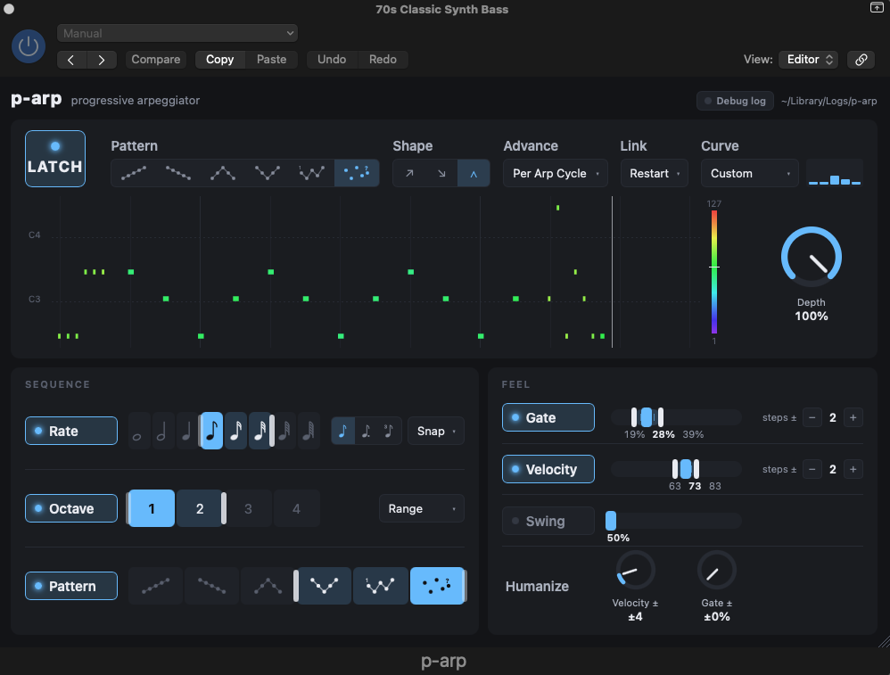

# p-arp

**p-arp** is a progressive arpeggiator for Logic Pro: an Audio Unit MIDI FX whose settings don't
have to stay put. The rate, octave range, pattern, gate, velocity and swing can each move through
a range of values as the arpeggio plays: a phrase that speeds up over a bar, climbs an octave each
cycle, swells toward the end of a loop, or drifts in and out of swing.



## Features

- Classic arpeggiator: patterns (Up, Down, Up/Down, Down/Up, As Played, Random), 24 tempo-synced
  rates (straight, dotted, triplet), octave range, gate, velocity, swing, latch.
- **Progressions**: each of those settings can follow a series around its base value, with its
  own spread below and above, number of steps, and shape (up, down, up-down, down-up, triangle or random).
- Series curves (linear, accelerating, Fibonacci, primes, random, or a custom drawn curve), linked
  or free-running series, and one Global Range control to widen or narrow everything at once.
- Locked to Logic's transport, including cycle loops; no stuck notes on loop wraps or stop.
- Factory presets, full automation of every parameter, and a live piano-roll view of the
  generated notes.

The [user manual](plugin/p-arp/docs/user-manual.md) ([PDF](plugin/p-arp/docs/p-arp-user-manual.pdf))
covers everything in detail.

## Requirements and status

Logic Pro on macOS 12 or later, Apple Silicon or Intel. Not GarageBand (no MIDI FX slot for
Audio Units). p-arp is a personal project, shared with friends; builds are ad hoc signed (no Apple
Developer ID), so macOS may need the quarantine flag cleared after downloading, as described in
the [manual](plugin/p-arp/docs/user-manual.md#1-installing).

## Building

Xcode, CMake and Node. See [plugin/p-arp/README.md](plugin/p-arp/README.md) for the release build,
engine tests, UI development with hot reload inside Logic, presets and packaging.

## Repository layout

```
plugin/p-arp/   the plugin: C++20 engine (no JUCE dependency, with tests), JUCE AU shell,
                React + TypeScript web UI, presets, user manual, packaging tools
docs/           Features.md (product definition and roadmap) and design-notes.md (Logic host
                behavior, design decisions and their reasons)
prototypes/     earlier stages, kept for reference: the Logic Scripter prototype (SARP) the
                engine was ported from, and the architecture spike
```
